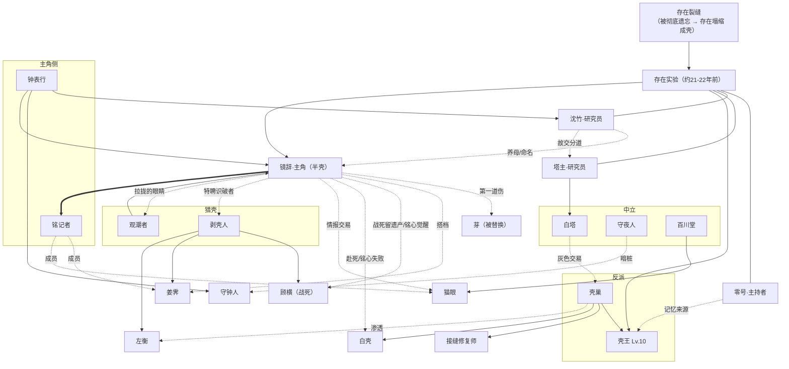

# 《他们不是人》人物·势力 网络拓扑图 · 生成提示词

> 用途：把下面的内容交给任意一个「能画图/能理解结构」的 AI 工具（Claude/GPT/Kimi/豆包生成 mermaid 或 SVG，或用 draw.io / ProcessOn / XMind 导入），即可生成一张准确的世界观网络拓扑图。
> 建议：**不要**交给纯文生图工具（Midjourney / DALL-E / 即梦），这类工具会把中文文字和连线关系画乱。拓扑图必须用「结构化生成」（mermaid / SVG / 思维导图）。

---

## 一、图的总目标

一张**双层网络拓扑图**：上层是 8 大势力，下层是 13 个关键人物，中间由「存在裂缝 → 存在实验」这条起源链串联。核心是主角 **镜辞**，他是所有关系线的汇聚点。

---

## 二、主提示词（可整段粘贴）

> 请生成一张中文小说《他们不是人》的「人物·势力网络拓扑图」。图分四层，自上而下：**世界底层 → 起源 → 势力 → 人物**。
>
> 【世界底层】一个节点「存在裂缝」：当一个人被彻底遗忘，他的存在会塌缩成"壳"。
> 【起源】一个节点「存在实验」（约21-22年前某机构试图让意识永生的失控实验），它由「零号」（主持者）、「沈竹」「塔主」三名研究员参与，实验撕开裂缝，产出两个极端产物：「壳王」（完美壳，复刻零号记忆却丢掉"被爱"）与「镜辞」（半壳，保留壳的感知却因沈竹的爱而"满"）。
> 【势力层】8 个势力节点，用不同颜色区分阵营：**壳巢**（反派源头，红色）、**白塔**（记忆机构，蓝色）、**守夜人**（古老看守，灰色）、**剥壳人**（官方猎壳机构，深蓝）、**观潮者**（民间猎壳，橙红）、**百川堂**（地下情报网，黄）、**钟表行**（主角据点，暖棕）、**铭记者**（主角自建势力，金色）。
> 【人物层】13 个关键人物节点，按所属势力归组，用连线连到各自势力。
>
> 【必须画出的关键连线】（每条都标注关系）：
> 存在裂缝 → 壳（凝结）、→ 刻痕者（留刻痕）、→ 镜辞（半壳，接口最深）、→ 白塔（商业化）；
> 存在实验 → 壳王、→ 镜辞（两个产物）；
> 沈竹 ↔ 塔主（故交同事，分道：情感守护 vs 技术修正）；沈竹 → 镜辞（养母，命名"镜辞"）；沈竹 → 守钟人（托付怀表与钟表行）；
> 壳巢 → 壳王（源头）、→ 接缝修复师（技术核心）、→ 白壳（叛徒）、→ 左衡（人类代理，渗透剥壳人共存派）；白塔 ↔ 壳巢（灰色交易，提供记忆原料）；
> 守夜人 → 守钟人（曾经的守夜人，隐退暗桩）；
> 剥壳人 → 顾横（主战派老兵）、→ 姜霁（行动员）、→ 左衡（共存派领袖）；观潮者 → 首领（被壳灭门幸存者）；百川堂 → 猫眼（窗口）；
> 镜辞 ← 剥壳人（第2卷特聘"识破者"）、← 观潮者（拉拢的"眼睛"）、← 百川堂（情报交易）；
> 镜辞 → 芽（青梅竹马，被壳替换，第一道伤）、→ 姜霁（搭档）、→ 顾横（战死留遗产，触发铭心觉醒）、→ 白壳（赴死，铭心失败名场面）、→ 铭记者（第7-8卷自建，首领）；
> 壳王 ← 零号（记忆来源，缺"被爱的记忆"）。
>
> 【视觉风格】现代信息图风格，深色背景，节点用圆角矩形，势力节点较大、人物节点较小；人物节点按所属势力着色描边；连线用带箭头细线，关键关系（血缘/托付/战死遗产）用实线加粗，次要关系用虚线；图例说明颜色含义。中文标注，字号清晰，整体布局中心辐射（镜辞居中偏下，势力环绕，起源链在顶部）。禁止堆叠文字，留白充足。

---

## 三、节点清单（精确，供逐项放置）

### A. 世界底层（1）
| 节点 | 说明 |
|---|---|
| 存在裂缝 | 世界底色：被彻底遗忘→存在塌缩成"壳" |

### B. 起源（存在实验，1+3人）
| 节点 | 说明 |
|---|---|
| 存在实验 | 约21-22年前失控实验，撕开裂缝、放大壳潮 |
| 零号 | 实验主持者，一生孤独从未被爱，壳王记忆来源 |
| 沈竹 | 研究员（载体生命维持），后带镜辞隐居钟表行 |
| 塔主 | 研究员（记忆映射算法），后建白塔 |

### C. 势力层（8）
| 势力 | 定位 | 对抗遗忘的方式 | 阵营色 |
|---|---|---|---|
| 壳巢 | 壳的组织化源头 | 完美替代（替代≠铭记，错误） | 红 |
| 白塔 | 记忆研究机构 | 记忆存档（存档≠铭记） | 蓝 |
| 守夜人 | 古老看守 | 守界（秩序≠温度） | 灰 |
| 剥壳人 | 官方猎壳机构 | 制度（流程≠真相） | 深蓝 |
| 观潮者 | 民间猎壳 | 杀光（恨） | 橙红 |
| 百川堂 | 地下情报网 | 记录/交易（信息≠记忆） | 黄 |
| 钟表行 | 主角据点·养母遗物信息站 | 日常锚点（上弦=承诺继续走） | 暖棕 |
| 铭记者 | 主角自建势力（第7-8卷） | 铭记（唯一正确） | 金 |

### D. 人物层（13，按阵营归组）
| 人物 | 所属势力 | 身份 | 天赋 |
|---|---|---|---|
| 镜辞 | 钟表行/铭记者 | 主角·半壳·识破者 | 主=镜返（真视·禁忌品），副=铭心（铭刻·异品） |
| 沈竹 | 钟表行 | 养母·第一铭记者·实验研究员 | —（已失踪） |
| 守钟人 | 钟表行/守夜人 | 守护者·暗桩 | 主=时间感知（真视·异品），副=镇封 |
| 芽 | —（独立） | 青梅竹马·被替换 | —（现为壳） |
| 壳王 | 壳巢 | 完美壳·终局 | 999 全属性 |
| 接缝修复师 | 壳巢 | 技术核心 | 主=蚀忆·异品，副=镇封 |
| 白壳 | 壳巢（叛徒） | 完美伪装者·想成为人 | 主=拟魂·摹刻绝品，副=铭刻 |
| 塔主 | 白塔 | 记忆机构之主·实验幸存者 | 技术（非天赋） |
| 姜霁 | 剥壳人（后独立） | 行动员 | 主=行为指纹（真视·良品），副=蚀忆 |
| 顾横 | 剥壳人 | 主战派老兵·无天赋 | 无（肌肉记忆战斗），第3卷战死 |
| 左衡 | 剥壳人 | 共存派领袖·被渗透 | 无（非刻痕者），第7卷信仰崩塌 |
| 猫眼 | 百川堂 | 情报窗口 | 主=信息直觉（真视·良品），副=蚀忆 |
| 零号 | （起源·已死） | 实验主持者 | —（记忆被壳王复刻） |

---

## 四、关系连线清单（精确到每条，供逐条画）

### 世界底层 → 各方
- 存在裂缝 → 壳（裂缝凝结）
- 存在裂缝 → 刻痕者（裂缝留刻痕）
- 存在裂缝 → 镜辞（半壳，接口最深）
- 存在裂缝 → 白塔（裂缝商业化）

### 起源链
- 存在实验 → 壳王（产物·完美壳）
- 存在实验 → 镜辞（产物·半壳）
- 零号 → 壳王（记忆来源，缺"被爱的记忆"）
- 沈竹 → 镜辞（养母，命名"镜辞"）
- 沈竹 → 守钟人（托付怀表/钟表行/镜辞）
- 沈竹 ↔ 塔主（故交同事，分道）

### 势力内部
- 壳巢 → 壳王（源头/信仰）
- 壳巢 → 接缝修复师（技术核心）
- 壳巢 → 白壳（叛徒·镜像）
- 壳巢 → 左衡（人类代理，渗透剥壳人共存派）
- 白塔 ↔ 壳巢（灰色交易，提供记忆原料）
- 守夜人 → 守钟人（曾经的守夜人，隐退暗桩）
- 剥壳人 → 顾横（主战派）
- 剥壳人 → 姜霁（行动员）
- 剥壳人 → 左衡（共存派领袖）
- 观潮者 → 首领（被壳灭门幸存者，待命名）
- 百川堂 → 猫眼（窗口）

### 主角关系网（镜辞为中心）
- 镜辞 → 芽（青梅竹马，被壳替换，第一道伤）
- 镜辞 → 姜霁（搭档）
- 镜辞 → 顾横（战死留遗产，触发"铭心"觉醒）
- 镜辞 → 白壳（赴死，"铭心"失败名场面）
- 镜辞 → 铭记者（第7-8卷自建，首领）
- 镜辞 ← 剥壳人（第2卷特聘"识破者"）
- 镜辞 ← 观潮者（拉拢的"眼睛"）
- 镜辞 ← 百川堂（情报交易）

### 终局闭环
- 铭记者 → 姜霁 / 猫眼 / 观潮者觉醒者 / 被救普通人（成员）

---

## 五、Mermaid 源码（成品基准，可直接粘贴渲染）

> 复制下面整段到任何支持 mermaid 的工具（Typora / Obsidian / Mermaid Live / draw.io 导入 / Claude/GPT 对话）即可得到图。这是「正确结构」的基准，别人生成时以此为准。

---

## 六、生成工具建议（按优先级）

1. **Mermaid 渲染**（最推荐）：上面第五节源码直接粘贴即可，零误差、零乱码。
2. **Claude / GPT / Kimi / 豆包**：把第二节主提示词整段粘贴，让它输出 mermaid 或 SVG。
3. **draw.io / ProcessOn / XMind**：把第三节节点清单 + 第四节关系清单逐条录入，最可控。
4. **不要用** Midjourney / DALL-E / 即梦等文生图：中文文字与连线关系必然画乱。

---

*此提示词基于《他们不是人》当前设定（8 势力 / 11 角色 + 塔主·零号），设定如有增改，节点清单与关系清单需同步更新。*
